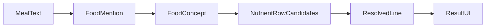

# 自然语言膳食解析 · 产品需求文档（PRD）

## 0. 对 GPT 方案的评估结论

GPT 方向 **正确且应采纳**，核心原则保留：

- 先切条目，再查库（避免整句扫描串扰）
- 日常食物概念层 ≠ USDA 完整品名
- 多候选 + 语义冲突过滤（禁止「第一个命中即采用」）
- 识别与份量分离；低置信度必须可见确认
- 模糊纠错只产候选，歧义交给用户

在现有产品约束下，对方案做这些 **收紧/补强**（相对 GPT 原文）：

| 点 | GPT 原文 | 本 PRD 定稿 |
|----|----------|-------------|
| 数据层 | 日常词典 + USDA | 明确 **三层**：Mention → Concept → NutrientRow（USDA/curated） |
| 无肉/油炸等 | 需语义证据 | 定义为 **属性门禁**：用户未说的特殊属性一律不得带入 |
| 奶茶等配方食物 | 确认容量配料 | 归为 **Recipe/复合食物**：默认可进「待确认」而非硬塞一条 FDC |
| 总分展示 | 低置信不悄悄进总量 | **可配置但默认：未确认行仍计入估算总分，但 UI 显著标记 + 汇总旁提示「含待确认」**（避免空白结果；信任靠标记而非静默） |
| 测试 | 语义规则 | 固化为 **回归包分类** + 与线上误识别样例挂钩 |
| 范围 | 偏理想完整 NLP | **V1 不做完整依存句法**；用分隔符/并列词切句 + 条目内修饰绑定即可 |

当前仓库已有雏形：[`src/lib/resolveMeal.ts`](../src/lib/resolveMeal.ts)（概念表 + 兼容性检查）+ [`src/lib/parseMeal.ts`](../src/lib/parseMeal.ts) 委托解析。本 PRD 既是产品准绳，也是评估/补齐该实现的清单。

---

## 1. 背景与问题

线上常见失败模式：

- **误识别**：`chicken` → 无肉炸鸡；`cooked` 脏别名串到无关食物
- **漏识别**：口语/拼写/复合词（milk tea、tomatos）未进结果
- **串扰**：整句扫描时，数量/修饰词绑错食物
- **假精确**：默认一份量静默进环图，用户以为很准

产品目标不是「USDA 行数最多」，而是：**用户说的每样东西，身份对、份量可改、猜错时看得见**。

---

## 2. 目标与非目标

### 目标（V1）

1. 一句话多食物时，**按条目独立**绑定数量与修饰。
2. 常见主食/蛋白/蔬果/种子 **身份稳定**（单复数、词序、常见拼写不影响概念）。
3. **禁止**在无证据时选中：meatless/vegan、fried/breaded、dried/sweetened 等特殊形态。
4. 份量缺失时：**假设默认份量但标注「请确认」**；配方不明时进入待确认，不伪装成精确数据库命中。
5. UI 区分三类来源：**数据库参考 / 类别估算 / 需要确认**。

### 非目标（V1 不做）

- 完整 LLM 解析或云端 API（保持客户端、零成本）
- 覆盖全部 USDA 短别名自动生成逻辑的「放开」
- 完美否定句（`salad without avocado` 可继续部分支持 + warning）
- 自动补全品牌配方奶茶的精确营养

---

## 3. 核心对象模型



- **FoodMention**：用户话语中的一段（保留原文切片与字符偏移）；含可选 qty/unit、加工词、拼写修正标记。
- **FoodConcept**：日常食物身份（如 `chicken`、`tomato`、`milk_tea`），与具体 FDC 行解耦。
- **NutrientRow**：可计算纤维的数据库行（curated / USDA），带加工、部位、形态属性。
- **ResolvedLine**：最终写入结果列表的一行：选中的 Row（或仅 Concept 占位）、份量状态、置信度、是否需确认。

---

## 4. 端到端流程（产品流程）

示例输入：`1 cup milk tea, grilled chicken, 2 tomatos`

```mermaid
sequenceDiagram
  participant U as User
  participant P as Parser
  participant D as ConceptDict
  participant N as NutrientDB
  participant UI as Results

  U->>P: meal text
  P->>P: split Mentions with spans
  Note over P: milk tea x1; grilled chicken; tomato x2 corrected
  loop each Mention
    P->>D: resolve Concept
    P->>N: candidates for Concept + attrs
    P->>P: score filter conflicts
    alt clear winner
      P->>UI: line confidence high or medium
    else ambiguous or recipe
      P->>UI: line needs_confirm + candidates
    end
  end
  UI->>U: editable list + confirm cues + total with caveat
```

### Step A — 切条目（Mention segmentation）

- 分隔优先：逗号、分号、`and`/`with`/`plus`、中文顿号等。
- 每个 Mention **只在自身 span 内** 解析数量、单位、加工词；禁止用整句全局「最近数字」抢绑。
- 输出示例：
  - 奶茶：qty=1，容量/配料未知，concept=`milk_tea`（recipe）
  - 鸡肉：method=`grilled`，重量未知，concept=`chicken`
  - 番茄：qty=2，size 未知，spelling_corrected=`tomatos→tomato`

### Step B — 概念解析（Concept）

- 查 **已审核日常词典**（非 USDA 自动短别名）。
- 允许：单复数、词形、有限同义词表、常见粘写（milktea）。
- 模糊匹配 **只进入候选列表**；若 top1/top2 接近且概念不同 → `needs_confirm`，不得静默替换。

### Step C — 营养行选择（NutrientRow）

对 Concept 拉取候选行，打分维度：

1. **主体一致**（chicken 不得落到 soy/meatless chicken 除非用户说了）
2. **加工一致**（grilled 优先 grilled；可用 generic cooked 回退；禁止 fried/breaded）
3. **无额外属性**（用户没说的 sweetened/dehydrated/canned 等降权或剔除）
4. **优势间隔**（最佳分明显高于第二，否则确认）

规则金句：**没有合格行 → 占位确认 / 类别估算，而不是硬塞最相似字符串。**

### Step D — 份量（与识别分离）

| 情况 | 行为 |
|------|------|
| 有明确 g/oz/cup/tbsp/count | 按单位换算，confidence 可高 |
| 仅有 count（2 tomatoes） | 用概念默认「1 个」重量 × N |
| 全无份量 | `assumed=true`，文案：「暂按 {default} 估算，请确认」 |
| Recipe（奶茶等） | 默认不假装精确 FDC；待确认容量/甜度，或低置信类别估算 |

### Step E — 汇总与展示

- 列表每行可见：名称、来源标签、份量、纤维、确认状态。
- 环图可用含假设行的估算总分，但必须有汇总提示：**「含待确认/假设份量」**。
- 用户改份量/换候选/删除后立即重算（已有编辑能力应对齐新状态字段）。

---

## 5. 置信度与 UI 标签（产品定义）

| 标签 | 含义 | 何时 |
|------|------|------|
| Database | 概念+行匹配充分，份量明确或合理默认 | high |
| Assumed portion | 身份较可信，份量是默认 | medium + 确认文案 |
| Needs confirm | 多候选冲突 / recipe / 仅模糊 | 展示候选或确认 CTA |
| Estimated | 无概念行，走类别估算 | low，沿用现有 estimate |

禁止把 Needs confirm / Estimated 显示成与可靠 Database 相同的「Database」徽章。

---

## 6. 词典与数据库治理

- **Concept 词典**：人工维护高频日常食物；持续用线上误识别扩增。
- **USDA 全库**：可保留供候选召回，但 **自动生成的短别名不得单独决胜**。
- **黑名单属性**：meatless、vegan nugget、fried、breaded、dehydrated、sweetened dried 等，无证据不可选。
- **Curated 行**：oatmeal/apple/chia 等继续作为优选默认。

---

## 7. 验收用例（语义回归，不只比总分）

必须覆盖：

1. 普通 `chicken` / `grilled chicken` ≠ meatless、≠ fried  
2. `2 cups cooked lentils` 只改扁豆份量，不引入洋蓟  
3. `tomatos` / `tomato` / `2 tomatoes` 同一概念，数量正确  
4. `milk tea` / `milktea` → recipe 待确认或低置信，不误成无关乳制品行  
5. 词序变化（`chicken grilled` vs `grilled chicken`）身份稳定  
6. 增加数量只影响对应 Mention  
7. 无法确定时出现确认/候选，而不是唯一「假精确」行  

实现上扩展 [`scripts/parser-regression.mjs`](../scripts/parser-regression.mjs)（或同等测试），按上表断言 **food id / 标签 / assumed**，而不仅是 `totalFiberG`。

---

## 8. 成功指标

- 线上抽样误识别（无肉/油炸串扰类）显著下降  
- `calculate_own` 后用户 **edit_portion** 仍可发生，但「删错食」比例下降（定性观察）  
- 回归包全绿；新增失败样例能在 1 次迭代内入库

---

## 9. 交付物与实现映射（确认 PRD 后的工程顺序）

1. 固化本 PRD 为仓库文档（如 `docs/PRD-meal-parsing.md`）  
2. 对齐/补齐 `resolveMeal`：切条、概念、冲突分、recipe 状态  
3. 扩展 `MatchedFood` / UI：Assumed / Needs confirm  
4. 回归包按第 7 节重写  
5. 用线上真实失败句做第二轮补丁  

---

## 10. 一句话产品原则

**先听懂用户说的每一样东西，再谨慎落到营养行；宁可标成待确认，也不要用错误的精确数字骗信任。**
